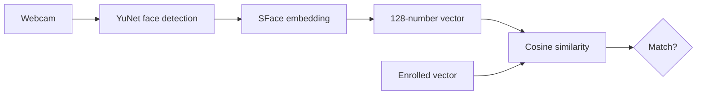

<div align="center">

# `ddosmode@linux:~$ ./build --future`

### OLD HARDWARE. NEW TRICKS.


</div>

## `> whoami`

I build **Linux automation, computer vision experiments, Telegram tooling and local-first assistants**. My favorite challenge: making supposedly obsolete hardware useful again.

```console
ddosmode@linux:~$ systemctl status imagination
● imagination.service - Active: running
  Platform: Linux
  Stack: Python · OpenCV · automation
  Mission: Less magic. More understanding.
```

## `> featured --bioauth`

### [BioAuth — Face verification on ordinary Linux computers](https://github.com/ddosmode/bioauth)

**A webcam, a neural network, and a vector of 128 numbers.**



> **Engineering, not magic.** This is an experimental camera-only face verifier, not Apple's Face ID. It does not currently provide liveness or anti-spoofing protection. Do not rely on it as your only login factor.

<div align="center">

[](https://github.com/ddosmode/bioauth)

</div>

## `> telemetry --live`

<div align="center">


</div>

## `> current_missions`

| Domain | Focus |
|:--|:--|
| **Computer vision** | Local face verification and biometric experiments |
| **Linux** | Automation, desktop integration, old hardware |
| **Local AI** | Offline voice interfaces and assistants |
| **Telegram** | Bots, clients, and messaging workflows |

## `> contribute`

Want to collaborate? Check out [BioAuth](https://github.com/ddosmode/bioauth), open an issue, submit a PR, or share compatibility tests. Please never upload personal biometric images or embeddings.

<div align="center">

**`LESS MAGIC. MORE UNDERSTANDING.`**


</div>
